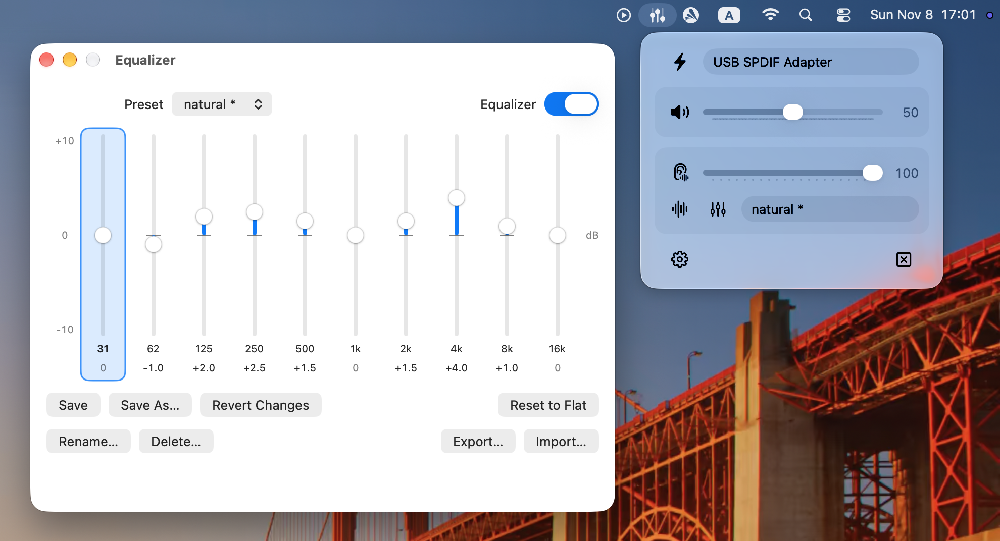
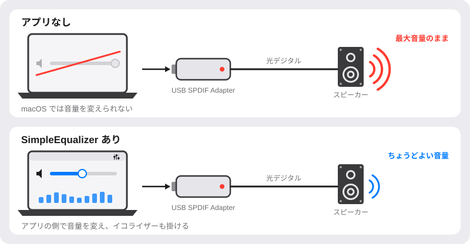
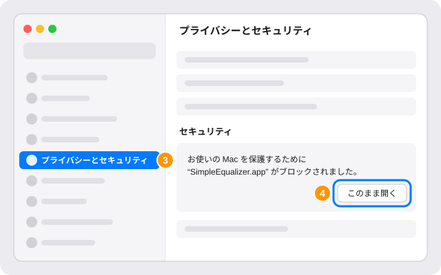
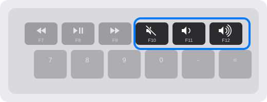

#  SimpleEqualizer

[English](README.md) | 日本語

ホームページ: https://tri9ster.github.io/SimpleEqualizer/ja/



Mac から光デジタル出力(USB SPDIF Adapter)などを通してスピーカーに音を出すときに、
macOS では変えられない音量を、アプリの側で変えるためのメニューバー常駐アプリです。イコライザーも掛けられます。



できるのは、音量の変更、消音、キーボードの音量キー、10 バンドのイコライザー、ラウドネス、プリセットの保存と呼び出しです。
画面は、日本語と英語に対応しています。

## 動く環境

- macOS 27 以降(Apple シリコンの Mac)
- 追加のドライバーは要りません。

## 使う前に

- **起動する前と、終了する前に、スピーカー側の音量を下げてください。**
  アプリが音量を下げているのは、アプリが動いている間だけです。
  終了したとき、「音声の加工」を切ったとき、アプリが落ちたときは、音が加工なしの最大音量に戻ります。
- 初めて使うときの音量は 100(元の音量のまま)です。起動したあと、ポップアップで下げてください。

## 入れ方

1. [Releases](../../releases) から、`SimpleEqualizer-<版>.dmg` をダウンロードして開きます。
2. SimpleEqualizer を「Applications」フォルダへドラッグします。

### はじめて開くとき(macOS に止められます)

このアプリは、Apple の公証を受けていません(作者が Apple の有料の開発者プログラムに入っていないため)。
そのため、はじめて開くときと、新しい版に入れ替えたときに、macOS に止められます。次の手順で開いてください。

1. 「アプリケーション」フォルダの SimpleEqualizer をダブルクリックします。
2. 「"SimpleEqualizer.app" は開いていません」と出たら、「完了」を押します(「ゴミ箱に入れる」は押さないでください)。
3. システム設定を開き、「プライバシーとセキュリティ」を選びます。

   

4. 下のほうの「セキュリティ」の欄に、「お使いの Mac を保護するために "SimpleEqualizer.app" がブロックされました。」と出ています。
   その右の「このまま開く」を押し、Mac のパスワードを入れます。
5. もう一度確かめる画面が出たら、「このまま開く」を押します。

### 許可を出す

- **システム音声の録音**: 音を加工するために要ります。初めて起動したときに求められるので、許可してください。
- **アクセシビリティ**: キーボードの音量キーを使うために要ります(下の「音量キー」)。

  

### 新しい版に入れ替えるとき

1. スピーカー側の音量を下げてから、SimpleEqualizer を終了します。
2. 新しい版の dmg から、「Applications」フォルダへドラッグして置き換えます。
3. 「はじめて開くとき」の手順が、もう一度要ります。許可(システム音声の録音、アクセシビリティ)は、出し直さなくて済みます。

## 使い方

起動すると、メニューバーにアイコンが出て、自動で音量の調整が始まります。Dock にはアイコンが出ません。

メニューバーのアイコンを押すと、ポップアップが開きます。ボタンはアイコンで、ボタン、スライダー、出力先とプリセットの欄にマウスを乗せると説明が出ます。
出力先とプリセットの欄を押すと、ポップアップの中に選択肢の一覧が広がります。選ぶと閉じます。選ばずに戻るときは、いちばん上の欄を押すか、Esc を押します。
入・切のあるボタンは、アイコンの絵が変わります(切のときは、斜線つきの稲妻、斜線つきの波形、波のない耳など)。

| 場所 | 項目 | 内容 |
| --- | --- | --- |
| いちばん上 | 音声の加工(稲妻のアイコン。切のときは斜線つき) | 押すと、アプリが音声に触るのをやめる(音は最大音量に戻るので、ポップアップの中で確かめる)。もう一度押すと再開する |
| いちばん上 | 出力先 | いまの出力先。選ぶと、Mac の出力先が切り替わる。アプリが加工できない装置には「(加工できません)」とつく |
| 音量の枠 | 音量(スライダーと、右の数値) | 0〜100。100 で元の音量、0 で無音。初めて使うときは 100(元の音量のまま) |
| 音量の枠 | 消音(スピーカーのアイコン) | 押すと音が消え、もう一度押すと戻る。音量の数値は変わらない。消音の間は、音量のスライダーを動かせない(数値も薄くなる) |
| 音質の枠 | ラウドネス(耳のアイコン。入のときは波つき) | 左のボタンで入・切を切り替え、スライダーで効き具合(0〜100。右に数値)を決める。音量を下げるほど、低音と高音を自動で持ち上げる |
| 音質の枠 | イコライザーの入・切(波形のアイコン。切のときは斜線つき) | 効果を聴き比べるときに使う |
| 音質の枠 | イコライザーを開く(スライダーのアイコン) | イコライザーのウィンドウを開く |
| 音質の枠 | プリセット | 保存したイコライザーの設定を、一覧から選んで呼び出す。名前のあとの `*` は、保存していない変更がある印 |
| いちばん下 | 設定(歯車のアイコン) | 設定のウィンドウを開く(下の「設定」) |
| いちばん下 | 終了(✕ のアイコン) | アプリを終える(音は最大音量に戻るので、ポップアップの中で確かめる。⌘Q のときは、確かめる画面が出る) |

音量、消音、イコライザーの設定、ラウドネスの強さと入・切は保存され、次に起動したときに元に戻ります。

## イコライザー

ポップアップの「イコライザーを開く」(スライダーのアイコン)で、ウィンドウが開きます。

- 10 本のスライダーが、低い音(31 Hz)から高い音(16 kHz)の順に並んでいます。
- つまみを上へ引くと、その高さの音が大きくなり、下へ引くと小さくなります。範囲は −10〜+10 dB、0.5 dB 刻みです。
- つまみは、引いた長さのぶんだけ動きます。スライダーの途中を押しても、値は変わりません。
- 「フラットに戻す」で、すべて 0 dB に戻ります。
- 矢印キーでも操作できます。左右で、動かすバンドを選びます(色と枠がつきます)。
  上下で 0.5 dB ずつ、Shift を押しながら上下で 2 dB ずつ変わります。
  キーが効かないときは、ウィンドウの余白かスライダーを一度押してください。
- スイッチを切にすると、値を残したまま、イコライザーの効果だけがなくなります。

「音量が大きいため、音を抑えています」と出たときは、上げた結果が、出せる大きさの上限を超えています。
音は割れませんが、つぶれて聞こえることがあります。音量を下げるか、上げているバンドを下げてください。

## 音量キー

キーボードの音量キー(上げる、下げる、消音)で、アプリの音量を変えられます。


- 初めて使うときは、「アクセシビリティ」の許可が必要です。ポップアップの「許可を求める…」を押し、
  システム設定の「アクセシビリティ」の一覧で、SimpleEqualizer をオンにしてください。許可すると、数秒で効き始めます。
  一覧に SimpleEqualizer が出ていないときは、一覧の下の「+」を押し、「アプリケーション」フォルダの SimpleEqualizer を選んで足します。
- 1回で、16 段階のうちの1段ぶん変わります。Option + Shift を押しながらだと、その 4 分の 1 ずつ変わります。
- 押すと、画面の下のほうに、音量の表示が少しの間だけ出ます。
- アプリが音量キーを受け取るのは、音声を加工している間だけです。「音声の加工」を切っているときや、アプリを終了したあとは、
  音量キーは macOS に戻ります。

## プリセット

イコライザーの設定(10 本のスライダーの値)に、名前をつけて保存できます。

- **保存する**: イコライザーのウィンドウでスライダーを動かし、「別名で保存…」を押して、名前をつけます。
- **呼び出す**: ポップアップか、イコライザーのウィンドウの「プリセット」から選びます。
- **上書きする**: プリセットを選んでスライダーを動かすと、名前のあとに `*` がつきます。「保存」で、そのプリセットを上書きします。
- **変更をやめる**: 「変更を戻す」で、選んでいるプリセットの値に戻ります。
- **名前を変える**: プリセットを選んで、「名前の変更…」を押します。
- **消す**: プリセットを選んで、「削除…」を押します。元に戻せないので、確かめる画面が出ます。
  消したあとは「フラット」に切り替わり、スライダーはすべて 0 dB になります。音を下げる設定だったときは、音が大きくなります。
- `*` がついたまま別のプリセットを選ぶと、変更を捨ててよいかを聞かれます。
- **バックアップを取る**: 「書き出し…」で、全部のプリセットを1つのファイルに書き出します。
- **バックアップから戻す**: 「読み込み…」で、書き出したファイルを選びます。いまの一覧に足されます(置き換わりません)。
  同じ名前があるときは、読み込んだ側の名前に番号がつきます(「映画 2」)。読み込んだだけでは、音は変わりません。
- 「フラット」(すべて 0 dB)は、はじめからあるプリセットで、上書きできません。英語の画面では「Flat」と出ます。
  「フラット」と「Flat」は、どちらもプリセットの名前に使えません。
- 同じ名前のプリセットは作れません。名前は 30 文字までです。
- プリセットに入るのは、スライダーの値だけです。音量、ラウドネスの強さと入・切、イコライザーの入・切は入りません。

## ラウドネス

小さい音量では、低音と高音が聞こえにくくなります。ラウドネスのスライダーを上げると、音量を下げるほど、低音と高音を自動で持ち上げます。

- スライダーは効き具合です。0 で効かず、100 でいちばん強く効きます。聴きながら、好みの位置にしてください。
- 音量 100 では、何も変わりません。音量 50 あたりで、いちばん強く効きます。それより音量を下げても、効き方は変わりません。
- スイッチを切にすると、強さを残したまま、ラウドネスの効果だけがなくなります。聴き比べるときに使います。切の間は、スライダーを動かせません(数値も薄くなります)。
- イコライザーを切にしても、ラウドネスは効いたままです。
- スピーカー本体にもラウドネスの設定がある場合は、二重に掛かります。アプリの側を使うときは、スピーカーの側を切ってください。

## 設定

ポップアップの歯車のアイコンで開きます。

- **出力先**: いまの出力先と、アプリの音量調整が有効かどうか。自動で下げる設定も、ここで切り替えられます。
- **音量キー**: 音量キーで、アプリの音量を変えるかどうか。切にすると、音量キーは macOS に任せます。
- **起動**: ログイン時に、自動で起動するかどうか。
- **言語**: 画面の言語(システムの設定に合わせる、日本語、English)。アプリを起動し直すと切り替わります。
  「システムの設定に合わせる」で、日本語でも英語でもない言語の Mac では、英語で出ます。
- **システム音声の録音**: 音を取り出せているか。この許可の状態は、アプリからは直接調べられないので、音を取り出せているかで判断しています。

## アイコンが警告の印に変わったとき

メニューバーのアイコンが三角の警告の印になっているときは、音声を加工していません。
元の音が最大音量で出ているおそれがあります。

1. スピーカー側の音量を下げる。
2. ポップアップを開き、出ている説明を読む。
3. ポップアップのいちばん上の稲妻のアイコンで、「音声の加工」を入れ直す。

## 「音を取り出せていません」と出たとき

「システム音声の録音」の許可がない可能性があります。許可がないと、音量を変えられません。

1. 案内の画面かポップアップの「設定を開く」を押す。
2. システム設定の「システムオーディオ録音のみ」の一覧で、SimpleEqualizer を許可する。
3. SimpleEqualizer を終了して、起動し直す。

許可があるのに出ることもあります(ほかのアプリが、無音のまま音の出力を動かしているとき)。
そのときは、閉じて構いません。音が流れ始めると、警告の印は消えます。

## 出力先

アプリは、macOS のいまの出力先の音を加工します。出力先を切り替えると、加工の対象も切り替わります。

- **macOS で音量を変えられない出力先**(USB SPDIF Adapter、音量を変えられないディスプレイのスピーカーなど):
  アプリの音量、消音、音量キー、ラウドネスが使えます。音量と消音は、出力先ごとに覚えています。
- **macOS で音量を変えられる出力先**(内蔵スピーカーなど): 音量は、macOS の音量で変えます。
  アプリの音量、消音、ラウドネスは使えません。イコライザーとプリセットは使えます。
  イコライザーで上げているバンドがあると、音がつぶれないよう、上げた分だけ全体を自動で下げます。
  小さくなった分は、macOS の音量で上げてください。自動で下げるのは、イコライザーのウィンドウの
  「増幅した分だけ、全体を自動で下げる」で切にできます(スピーカーごとに音量を合わせて、聴き比べるとき)。
- イコライザーの設定は、どの出力先でも同じです。出力先に合わせたいときは、プリセットを切り替えます。
- 対応していない出力先(チャンネル数が 2 でないものなど)では、アプリは音声に触らず、ポップアップに理由を出します。

## 設定の保存先

`~/Library/Application Support/SimpleEqualizer/` に、2つのファイルがあります。

| ファイル | 中身 |
| --- | --- |
| `state.json` | 音量、消音、イコライザーのいまの値、ラウドネスの強さと入・切、選んでいるプリセット |
| `presets.json` | 保存したプリセット |

同じ場所に `presets.broken-…` や `presets.partial-…`、`state.broken-…` という名前のファイルができることがあります。
読めなかったファイルを、アプリが残したものです。中身を確かめて、要らなければ消して構いません。

設定を最初からやり直したいときは、アプリを終了してから、`state.json` を消します(プリセットは残ります)。
次に起動すると、音量 100、イコライザーはすべて 0 dB で始まります。先に、スピーカー側の音量を下げてください。

`state.json` が壊れていて読めなかったときは、音量 30 で始まります。
`presets.json` が読めなかったときは、音量は変わらず、プリセットが「フラット」だけで始まります。
一部のプリセットだけが読めなかったときは、読めた分が一覧に出ます。
どちらの場合も、ポップアップに説明が出ます。

## アンインストール

1. スピーカー側の音量を下げてから、SimpleEqualizer を終了します。
2. 「アプリケーション」フォルダの SimpleEqualizer を、ゴミ箱に入れます。
3. 設定とプリセットも消すときは、`~/Library/Application Support/SimpleEqualizer/` を消します。
4. システム設定の「ログイン項目」「アクセシビリティ」「システムオーディオ録音のみ」に SimpleEqualizer が残っていれば、外します。

## いまの制限

- 動くことを確かめてあるのは、USB SPDIF Adapter、内蔵スピーカー、ディスプレイのスピーカー(どれも 2 チャンネル)です。
- 再生する音源のサンプリング周波数が変わる(44.1 kHz と 48 kHz)と、アプリは、新しい周波数で加工をし直します。
  その瞬間に、音が少し乱れることがあります。

## ソースからのビルド

Xcode 27 が要ります。ターミナルで、このリポジトリのフォルダに移ってから実行します。

```bash
xcodebuild -project SimpleEqualizer.xcodeproj -scheme SimpleEqualizer -configuration Release build
open ~/Library/Developer/Xcode/DerivedData/SimpleEqualizer-*/Build/Products/Release/SimpleEqualizer.app
```

`Config/Signing.xcconfig` がなくても作れます。その場合は、その場かぎりの署名になり、作り直すたびに、
「システム音声の録音」と「アクセシビリティ」の許可が外れます(出し直しが要ります)。
自分の証明書で署名したいときは、`Config/Signing.xcconfig.example` を `Config/Signing.xcconfig` に写して書き換えます。

音を出さずに確かめられる部分の自動テストは、次で動きます。

```bash
swift test --package-path Core
```

## 免責事項と利用許諾

- 本アプリケーションを利用することで発生する損害に対しては、作者は一切の責任を負いません。
- 不具合や操作の誤りで、大きな音が出ることがあります。スピーカーや耳を傷めないよう、スピーカー側の音量を下げて使ってください。
- このアプリは、動くことや、目的に合うことを保証しません。
- 「このまま開く」で開くかどうかは、ご自身で判断してください。ソースコードは公開しています。
- 質問への回答、不具合の修正、新しい macOS への対応は約束しません。予告なく公開をやめることがあります。
- このアプリは個人が作ったもので、Apple Inc. とは関係がありません。Apple、Mac、macOS は、Apple Inc. の商標です。
- MIT License です。くわしくは [LICENSE](LICENSE) を見てください。
