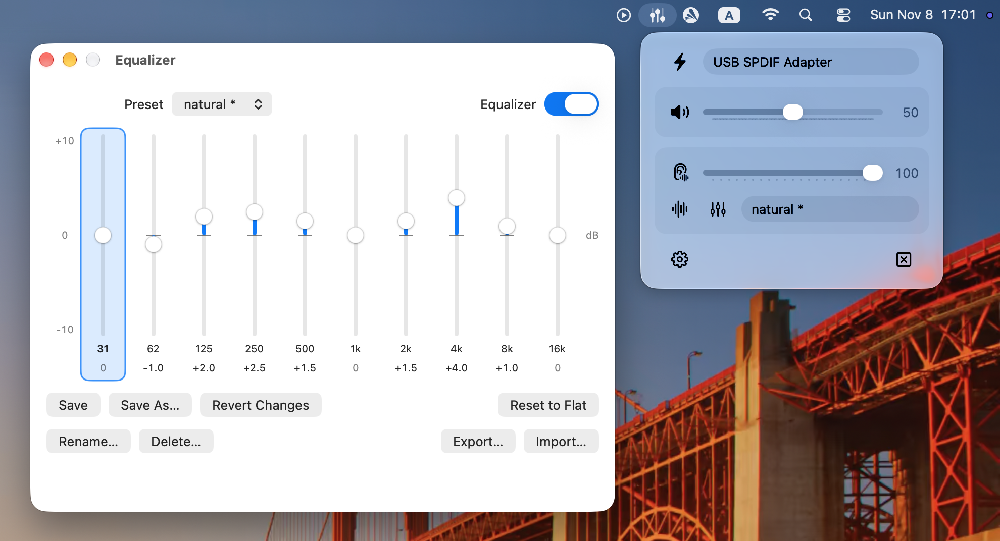
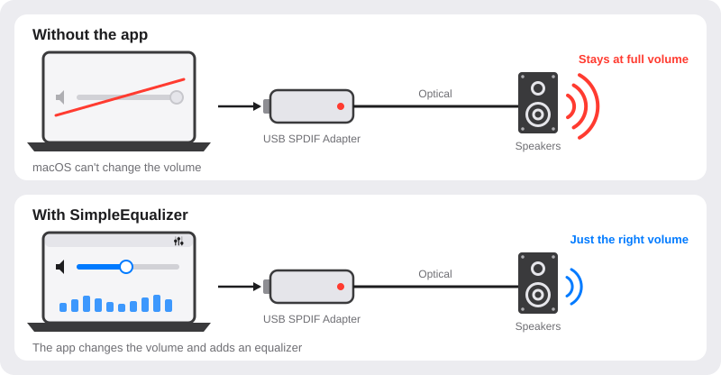
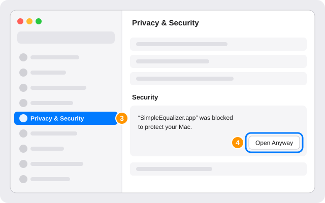
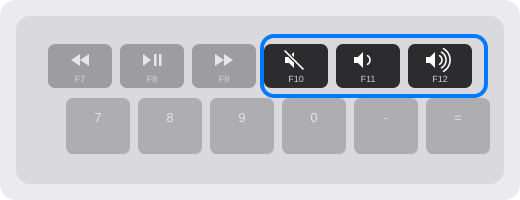

#  SimpleEqualizer

English | [日本語](README.ja.md)

Website: https://tri9ster.github.io/SimpleEqualizer/



A menu bar app for macOS that controls the volume in the app itself, for outputs whose volume macOS can't change,
such as an optical digital output (USB SPDIF Adapter) to your speakers. It also adds an equalizer.



It provides volume control, mute, the keyboard volume keys, a 10-band equalizer, loudness, and saved presets.
The app's screens are available in English and Japanese.

## Requirements

- macOS 27 or later (Mac with Apple silicon)
- No extra drivers are needed.

## Before you start

- **Turn down the volume on your speakers before you open the app and before you quit it.**
  The app lowers the volume only while it is running.
  When you quit the app, turn off "Audio processing", or the app crashes, the sound returns to full volume without processing.
- The volume starts at 100 (the original volume) the first time. Lower it in the popup after opening the app.

## Installation

1. Download `SimpleEqualizer-<version>.dmg` from [Releases](../../releases) and open it.
2. Drag SimpleEqualizer to the Applications folder.

### Opening it for the first time (macOS blocks it)

This app is not notarized by Apple (the author is not a member of Apple's paid Developer Program).
macOS blocks it the first time you open it and each time you install a new version. Open it as follows.

1. Double-click SimpleEqualizer in the Applications folder.
2. When you see '"SimpleEqualizer.app" Not Opened', click "Done" (do not click "Move to Trash").
3. Open System Settings and choose "Privacy & Security".

   

4. Near the bottom, in the "Security" section, you will see '"SimpleEqualizer.app" was blocked to protect your Mac.'
   Click "Open Anyway" next to it and enter your Mac password.
5. If macOS asks again, click "Open Anyway".

### Permissions

- **System Audio Recording**: needed to process the sound. macOS asks for it the first time you open the app. Allow it.
- **Accessibility**: needed to use the keyboard volume keys (see "Volume keys" below).

  

### Installing a new version

1. Turn down the volume on your speakers, then quit SimpleEqualizer.
2. Drag the app from the new dmg to the Applications folder to replace it.
3. Follow "Opening it for the first time" again. You don't need to grant the permissions (System Audio Recording, Accessibility) again.

## Usage

When the app opens, its icon appears in the menu bar and it starts controlling the volume automatically. It has no Dock icon.

Click the menu bar icon to open the popup. The buttons are icons; hold the pointer over a button, a slider, or the Output and Preset fields to see a description.
Clicking the Output or Preset field expands a list of choices inside the popup. Choosing one closes it. To go back without choosing, click the top field or press Esc.
Buttons that turn something on and off change their icon (when off: a slashed bolt, a slashed waveform, an ear without waves, and so on).

| Area | Item | Description |
| --- | --- | --- |
| Top | Audio processing (bolt icon; slashed when off) | Click to stop the app from touching the sound (the popup asks you to confirm, because the sound returns to full volume). Click again to resume |
| Top | Output | The current output. Choosing one switches the Mac's output. Devices the app can't process are marked "(can't process)" |
| Volume | Volume (slider and the number on the right) | 0–100. 100 is the original volume, 0 is silent. Starts at 100 (the original volume) the first time |
| Volume | Mute (speaker icon) | Click to mute, click again to unmute. The volume number doesn't change. While muted, the volume slider can't be moved (the number is dimmed) |
| Sound | Loudness (ear icon; with waves when on) | The button on the left turns it on and off, and the slider sets the amount (0–100, shown on the right). The lower the volume, the more it boosts the bass and treble |
| Sound | Equalizer on/off (waveform icon; slashed when off) | Use it to compare the sound with and without the equalizer |
| Sound | Open Equalizer (sliders icon) | Opens the Equalizer window |
| Sound | Preset | Choose a saved equalizer setting from the list. A `*` after the name means there are unsaved changes |
| Bottom | Settings (gear icon) | Opens the Settings window (see "Settings" below) |
| Bottom | Quit (✕ icon) | Quits the app (the popup asks you to confirm, because the sound returns to full volume; ⌘Q shows a confirmation dialog) |

The volume, mute, equalizer settings, and the loudness amount and on/off state are saved and restored the next time you open the app.

## Equalizer

Click "Open Equalizer" (sliders icon) in the popup to open the window.

- Ten sliders are arranged from low (31 Hz) to high (16 kHz).
- Drag a knob up to make that range louder, or down to make it quieter. The range is −10 to +10 dB in 0.5 dB steps.
- A knob moves by the distance you drag it. Clicking elsewhere on a slider doesn't change the value.
- "Reset to Flat" sets every band to 0 dB.
- You can also use the arrow keys. Left and right choose the band (it is highlighted with a color and a frame).
  Up and down change it by 0.5 dB, or by 2 dB while holding Shift.
  If the keys don't work, click an empty area of the window or a slider once.
- Turning the switch off removes the equalizer's effect while keeping the values.

If you see "The sound is being limited because the volume is high", the boosted sound exceeds the maximum level the app can output.
The sound won't clip, but it may sound squashed. Lower the volume or lower the boosted bands.

## Volume keys

You can change the app's volume with the keyboard volume keys (up, down, mute).


- The first time, the app needs Accessibility permission. Click "Request Permission…" in the popup,
  then turn on SimpleEqualizer in the Accessibility list in System Settings. The keys start working a few seconds after you allow it.
  If SimpleEqualizer is not in the list, click "+" below the list and add SimpleEqualizer from the Applications folder.
- Each press changes the volume by one of 16 steps. Holding Option + Shift changes it by a quarter of a step.
- A volume indicator appears briefly near the bottom of the screen.
- The app receives the volume keys only while it is processing audio. When "Audio processing" is off or the app has quit,
  the volume keys go back to macOS.

## Presets

You can save the equalizer settings (the values of the 10 sliders) under a name.

- **Save**: move the sliders in the Equalizer window, click "Save As…", and enter a name.
- **Load**: choose one from "Preset" in the popup or the Equalizer window.
- **Overwrite**: when you choose a preset and move a slider, a `*` appears after the name. "Save" overwrites that preset.
- **Discard changes**: "Revert Changes" returns to the values of the selected preset.
- **Rename**: choose a preset and click "Rename…".
- **Delete**: choose a preset and click "Delete…". This can't be undone, so a confirmation appears.
  After deleting, the app switches to "Flat" and every slider goes to 0 dB. If the preset lowered the sound, it becomes louder.
- If you choose another preset while a `*` is shown, the app asks whether to discard the changes.
- **Back up**: "Export…" writes all presets to a single file.
- **Restore**: "Import…" lets you choose an exported file. Its presets are added to the current list (not replaced).
  If a name already exists, a number is added to the imported one ("Movie 2"). Importing alone doesn't change the sound.
- "Flat" (all 0 dB) is a built-in preset and can't be overwritten. It appears as "フラット" on Japanese screens.
  Neither "Flat" nor "フラット" can be used as a preset name.
- You can't create two presets with the same name. Names can be up to 30 characters long.
- A preset contains only the slider values. It doesn't include the volume, the loudness amount and on/off state, or the equalizer on/off state.

## Loudness

At low volumes, bass and treble are harder to hear. When you raise the loudness slider, the app boosts the bass and treble more as you lower the volume.

- The slider sets the amount. 0 has no effect, 100 has the strongest effect. Set it to taste while listening.
- At volume 100, nothing changes. The effect is strongest around volume 50 and stays the same below that.
- Turning the switch off removes the loudness effect while keeping the amount, so you can compare. While it is off, the slider can't be moved (the number is dimmed).
- Loudness stays on even when the equalizer is off.
- If your speakers also have a loudness setting, both apply. When you use the app's loudness, turn off the speakers' one.

## Settings

Open it with the gear icon in the popup.

- **Output**: the current output and whether the app's volume control is on. You can also turn the automatic volume lowering on or off here.
- **Volume Keys**: whether the volume keys change the app's volume. When off, the volume keys are left to macOS.
- **Startup**: whether the app opens automatically at login.
- **Language**: the display language (Use System Setting, 日本語, English). The language changes the next time you open the app.
  With "Use System Setting", the app uses English on a Mac set to a language other than Japanese or English.
- **System Audio Recording**: whether the app can capture sound. The app can't check this permission directly, so it judges by whether it can capture sound.

## When the icon turns into a warning sign

When the menu bar icon is a triangular warning sign, the app is not processing audio.
The original sound may be playing at full volume.

1. Turn down the volume on your speakers.
2. Open the popup and read the message.
3. Turn "Audio processing" back on with the bolt icon at the top of the popup.

## When you see "Can't Capture Sound"

The app may not have System Audio Recording permission. Without it, the app can't change the volume.

1. Click "Open Settings" in the message or in the popup.
2. Allow SimpleEqualizer in the "System Audio Recording Only" list in System Settings.
3. Quit SimpleEqualizer and open it again.

This message can also appear when the app does have permission (when another app keeps the audio output running silently).
In that case, you can close it. The warning sign disappears once sound starts playing.

## Outputs

The app processes the sound for the current macOS output. When you switch the output, the app switches with it.

- **Outputs whose volume macOS can't change** (USB SPDIF Adapter, display speakers without volume control, and so on):
  the app's volume, mute, volume keys, and loudness are available. The volume and mute are remembered for each output.
- **Outputs whose volume macOS can change** (built-in speakers, and so on): use the macOS volume.
  The app's volume, mute, and loudness aren't available. The equalizer and presets are.
  When some equalizer bands are boosted, the app automatically lowers the overall volume by the boost so the sound isn't squashed.
  Use the macOS volume to make up the difference. You can turn off this automatic lowering with
  "Automatically lower the overall volume by the boost" in the Equalizer window (for example, to compare speakers at matched volumes).
- The equalizer settings are the same for every output. To match an output, switch presets.
- On unsupported outputs (for example, those without exactly 2 channels), the app doesn't touch the sound and shows the reason in the popup.

## Where settings are stored

There are two files in `~/Library/Application Support/SimpleEqualizer/`.

| File | Contents |
| --- | --- |
| `state.json` | The volume, mute, current equalizer values, loudness amount and on/off state, and the selected preset |
| `presets.json` | Saved presets |

Files named `presets.broken-…`, `presets.partial-…`, or `state.broken-…` may appear in the same place.
The app keeps files it couldn't read under these names. Check their contents and delete them if you don't need them.

To start over with the settings, quit the app and delete `state.json` (presets are kept).
The next time you open the app, it starts at volume 100 with every equalizer band at 0 dB. Turn down the volume on your speakers first.

If `state.json` is damaged and can't be read, the app starts at volume 30.
If `presets.json` can't be read, the volume doesn't change and the app starts with only "Flat".
If only some presets can't be read, the readable ones appear in the list.
In each case, the popup shows a message.

## Uninstalling

1. Turn down the volume on your speakers, then quit SimpleEqualizer.
2. Move SimpleEqualizer in the Applications folder to the Trash.
3. To also delete the settings and presets, delete `~/Library/Application Support/SimpleEqualizer/`.
4. If SimpleEqualizer remains in "Login Items", "Accessibility", or "System Audio Recording Only" in System Settings, remove it.

## Limitations

- It has been tested with a USB SPDIF Adapter, built-in speakers, and display speakers (all 2 channels).
- When the sample rate of the audio changes (44.1 kHz and 48 kHz), the app restarts processing at the new rate.
  The sound may be briefly disturbed at that moment.

## Building from source

You need Xcode 27. In Terminal, go to the folder of this repository and run:

```bash
xcodebuild -project SimpleEqualizer.xcodeproj -scheme SimpleEqualizer -configuration Release build
open ~/Library/Developer/Xcode/DerivedData/SimpleEqualizer-*/Build/Products/Release/SimpleEqualizer.app
```

You can build without `Config/Signing.xcconfig`. In that case the app is ad-hoc signed, and each rebuild removes
the System Audio Recording and Accessibility permissions (you need to grant them again).
To sign with your own certificate, copy `Config/Signing.xcconfig.example` to `Config/Signing.xcconfig` and edit it.

Automated tests for the parts that can be checked without playing sound run with:

```bash
swift test --package-path Core
```

## Disclaimer and license

- The author is not liable for any damage resulting from the use of this app.
- A bug or a mistake in use can cause loud sound. To protect your speakers and your hearing, keep the volume on your speakers low.
- This app comes with no warranty that it works or that it fits your purpose.
- Whether to open the app with "Open Anyway" is your own decision. The source code is public.
- Answers to questions, bug fixes, and support for new versions of macOS are not promised. Distribution may stop without notice.
- This app is made by an individual and is not affiliated with Apple Inc. Apple, Mac, and macOS are trademarks of Apple Inc.
- MIT License. See [LICENSE](LICENSE) for details.
